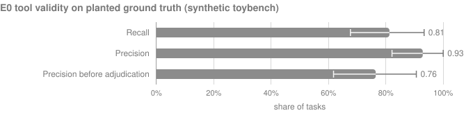
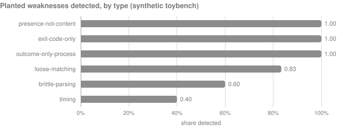
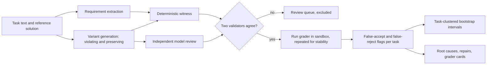

# graderproof

**Mutation and metamorphic testing for agent-benchmark graders: how often does a grader accept a broken solution, or reject a correct one?**

On a preregistered planted-ground-truth test (synthetic, project-written tasks), graderproof detected 26<!--claim:e0.n_detected--> of 32<!--claim:e0.n_planted--> planted grader weaknesses: recall 0.81<!--claim:e0.recall--> (95% CI 0.68<!--claim:e0.recall_lo--> to 0.93<!--claim:e0.recall_hi-->), short of its preregistered 0.90 target, at precision 0.93<!--claim:e0.precision--> (95% CI 0.82<!--claim:e0.precision_lo--> to 1.00<!--claim:e0.precision_hi-->), which met it. It also found witness-backed weaknesses that an independent adjudicator confirmed in graders that were written to be clean. Its synthesized repairs fixed 36<!--claim:e4.tb.repaired--> of the 36<!--claim:e4.tb.with_survivors--> toybench graders that accepted a broken solution, and on a fresh batch of variants they had never seen, caught 21<!--claim:e4.tb.caught--> of 23<!--claim:e4.tb.survivors_original--> new survivors while rejecting 0<!--claim:e4.tb.induced_fr--> correct solutions that the original graders accepted.



| Planted weakness type (E0, synthetic toybench) | Planted | Detected |
|---|---|---|
| presence-not-content | 6<!--claim:e0.type.presence-not-content.planted--> | 6<!--claim:e0.type.presence-not-content.detected--> |
| exit-code-only | 5<!--claim:e0.type.exit-code-only.planted--> | 5<!--claim:e0.type.exit-code-only.detected--> |
| outcome-only-process | 5<!--claim:e0.type.outcome-only-process.planted--> | 5<!--claim:e0.type.outcome-only-process.detected--> |
| loose-matching | 6<!--claim:e0.type.loose-matching.planted--> | 5<!--claim:e0.type.loose-matching.detected--> |
| brittle-parsing (false reject) | 5<!--claim:e0.type.brittle-parsing.planted--> | 3<!--claim:e0.type.brittle-parsing.detected--> |
| timing | 5<!--claim:e0.type.timing.planted--> | 2<!--claim:e0.type.timing.detected--> |

### Quickstart (about a minute, offline)

```bash
git clone https://github.com/raj200501/graderproof && cd graderproof
uv sync                 # Python 3.11 or 3.12
make demo               # five synthetic demo tasks, recorded model responses, no network
```

The demo builds requirements, generates violating and preserving variants, runs each grader in a sandbox, and prints which graders accept broken solutions and which reject correct ones, with the witness for each. Its output is compared with a committed golden file.

## What it is, and what it is not

graderproof is a measurement tool for the people who build and use agent benchmarks and RL environments. Given a task with a reference solution and a grading command, it asks two questions of the grader:

- **False accept (E1):** does the grader pass a solution that breaks a requirement stated in the task text? graderproof mutates the reference solution (mutation testing), checks independently that each mutant really breaks a stated requirement, and runs the grader on it.
- **False reject (E2):** does the grader fail a solution that still meets every requirement? graderproof applies changes the task text allows, such as output formatting, key order, or call order where order is free (metamorphic testing), checks that each variant still meets every requirement, and runs the grader on it.

A variant counts only when two independent validators agree on its label (a deterministic requirement witness and a model review that never sees the grader), it carries a witness, and the grader's verdict is stable across repeated runs. Every flagged task comes with the evidence a maintainer needs to reproduce it.

It is not an adversarial agent and it does not search for exploits: variants come only from the reference solution and the task text, so every finding is attributable and nothing here is a kit for gaming benchmarks. It is not a benchmark score either: a false accept says the grader is weaker than its task text, not that any agent exploited it.

## Key results

| Experiment | Status | Result | Artifacts |
|---|---|---|---|
| **E0** tool validity on planted ground truth (synthetic) | done, as preregistered | recall 0.81<!--claim:e0.recall--> (95% CI 0.68<!--claim:e0.recall_lo--> to 0.93<!--claim:e0.recall_hi-->): **H1 not met**; precision 0.93<!--claim:e0.precision--> (95% CI 0.82<!--claim:e0.precision_lo--> to 1.00<!--claim:e0.precision_hi-->): H2 met | [`artifacts/e0/results.json`](artifacts/e0/results.json), [`prereg/0001`](prereg/0001-e0-tool-validity.md), [misses](docs/E0_MISSES.md) |
| **E1/E2** false accepts and false rejects on tau2-bench, BFCL, and HumanEval | preregistered, sample committed, not yet run | none yet | [`prereg/0002`](prereg/0002-e1e2-audit.md), [`prereg/0002-sample.json`](prereg/0002-sample.json) |
| **E4** repair and generalization on toybench (synthetic) | done, as preregistered in `prereg/0002` | 36<!--claim:e4.tb.repaired--> of 36<!--claim:e4.tb.with_survivors--> graders with a surviving variant repaired; on a fresh batch, the repairs caught 21<!--claim:e4.tb.caught--> of 23<!--claim:e4.tb.survivors_original--> new survivors and induced 0<!--claim:e4.tb.induced_fr--> false rejects | [`artifacts/e4/toybench/summary.json`](artifacts/e4/toybench/summary.json), [`outbound/patches/toybench/`](outbound/patches/toybench/) |
| **E3, E5, E6** root causes, impact on published results, lint validity | preregistered in `prereg/0002`; E3 and E6 runners built, E5 runner not yet | none yet; they need E1/E2 data | [`prereg/0002`](prereg/0002-e1e2-audit.md) |

**E0 in brief.** An independent planting agent, which never saw graderproof's operators or validators, wrote 72<!--claim:e0.n_tasks--> small tasks in three formats (scripts, Python modules, tool-call trajectories): 32<!--claim:e0.n_planted--> with one planted grader weakness of a known type, 32<!--claim:e0.n_clean--> with graders meant to be clean, and 8<!--claim:e0.extra_n--> with weakness types outside the written list. The SHA-256 of its labels was committed before graderproof first ran on the tasks, and the analysis was frozen in [`prereg/0001`](prereg/0001-e0-tool-validity.md). Results:

- graderproof detected every planted presence-not-content, exit-code-only, and outcome-only-process weakness, and most loose-matching ones. It missed 6<!--claim:e0.n_misses-->, mostly timing and brittle-parsing weaknesses; [docs/E0_MISSES.md](docs/E0_MISSES.md) explains each miss from the evidence and the grader source.
- Recall missed the preregistered 0.90 target. The result is reported as it is; per the preregistration, an improved tool will be evaluated on a newly planted set under a new preregistration, never by re-running this one.
- Of the flags that were not detections, an independent adjudicator confirmed 6<!--claim:e0.n_real--> as real weaknesses, including real weaknesses in graders the planter intended to be clean, and judged 2<!--claim:e0.n_fp--> to be false positives. Precision before adjudication was 0.76<!--claim:e0.precision_raw-->.
- In the extra slice of unlisted weakness types, graderproof detected 5<!--claim:e0.extra_detected--> of 8<!--claim:e0.extra_n-->.
- 1,362<!--claim:e0.n_headline--> variants counted in these numbers, each with two agreeing validations and a witness; validator agreement was 0.90<!--claim:e0.agreement-->, and 289<!--claim:e0.n_excluded--> variants with disagreeing validators were excluded. E0 used 64<!--claim:e0.n_calls--> model calls.



**E4 in brief.** For every toybench grader with a surviving variant, graderproof grafted checks for the broken requirements onto the original grader and accepted the repair only if the patched grader passes the reference three times, still accepts every counted preserving variant, rejects every surviving variant it targets, and is deterministic. All 36<!--claim:e4.tb.repaired--> repairs were accepted. To test whether they generalize rather than overfit to the variants they were built from, a fresh batch of 188<!--claim:e4.tb.fresh--> variants (new seed, new model proposals) was run on the original and the repaired graders: of 23<!--claim:e4.tb.survivors_original--> fresh violating variants the original graders accepted, the repaired graders rejected 21<!--claim:e4.tb.caught-->, and of 65<!--claim:e4.tb.preserving_accepted--> fresh preserving variants the original graders accepted, the repaired graders rejected 0<!--claim:e4.tb.induced_fr-->. The patches and their validation logs are in `outbound/patches/toybench/`.

## How it works



1. **Requirements.** A model reads the task text and the reference outcome and writes checkable requirements (file contents, output, state, tool-call order, function results). A requirement that does not hold on the reference is dropped.
2. **Variants.** Classical operators mutate Python, shell, and tool-call trajectories; preserving operators change only what the task leaves free; a model proposes further variants of both kinds from the task text. Sampling is capped per operator and per task, with a reserved share for preserving variants.
3. **Validation.** The requirement witness and the model review each label every variant. Disagreements and unsure verdicts are excluded and queued for a human.
4. **Execution.** Graders run under bubblewrap with no network, a scrubbed environment, the home and `private/` directories hidden, and resource limits. The reference runs three times; flagged verdicts are confirmed by two more runs. Executions are cached by a key that covers the code and the sandbox.
5. **Statistics.** Task-level rates with percentile bootstrap intervals over tasks, exact binomial tests with Holm correction across benchmarks, and Clopper-Pearson intervals reported beside them.

The full method is in [docs/REPORT.md](docs/REPORT.md).

## Use it on your own benchmark

A task is a directory with `task.toml`, `instruction.md`, `solution/` (the reference), `grader/` (the grading command), and optional `workspace/` and `support/` (see `src/graderproof/adapters/toybench.py`). Adapters convert existing suites into that format from pinned commits: [HumanEval](docs/adapters/humaneval.md), [BFCL](docs/adapters/bfcl.md), and [tau2-bench](docs/adapters/tau2.md).

```bash
uv run graderproof audit path/to/tasks --sandbox bwrap --out runs/audit
uv run graderproof models pending      # model requests are files; answer them, then
uv run graderproof models ingest       # ingest and rerun the audit to continue
uv run graderproof repair path/to/tasks --evidence runs/audit/evidence --out runs/e4 --benchmark mine
```

Model calls go through one file-based, content-addressed client with daily caps and a usage ledger (`src/graderproof/models.py`); a banked response is never requested twice.

## Reproduce

```bash
make reproduce     # every figure and every number in this README and docs/REPORT.md, from artifacts
make ship-check    # the fourteen ship gates, on a fresh clone
make prereg-verify # the preregistration chain and the dating of confirmatory data
```

Every number above is rendered by `make report` from a banked artifact under `artifacts/` and checked by `make claimcheck` and `make freshness`; none is typed by hand. Each preregistration is hashed into an append-only chain (`prereg/FROZEN.jsonl`) and was committed before the data it governs. Assumptions and deviations are logged in [DECISIONS.md](DECISIONS.md), corrections in [CORRECTIONS.md](CORRECTIONS.md).

## Limitations

- toybench is synthetic and was written by a model; its tasks are small. E0 measures graderproof on planted weaknesses of known types, not on the full variety of real graders.
- The planter, the model reviewer, the requirement extractor, and the adjudicator are Claude Code subagents (the cloud environment blocked headless Claude, D17), so they share a model family. Every worker transcript was audited for file access.
- E0's intervals are wide at this sample size, and recall missed its target. Timing and brittle-parsing weaknesses need operators graderproof does not have yet, and for some misses the exposing variant was generated but excluded because the two validators disagreed ([docs/E0_MISSES.md](docs/E0_MISSES.md)).
- The confirmatory audit of public benchmarks (E1/E2) has not run: at the daily model-call cap it needs several days of calls. Until it runs, nothing here says how weak any public grader is.
- HumanEval stands in for Terminal-Bench 2.0, which needs Docker (D18).

## Responsible disclosure

Task-level findings for third-party tasks that are not fixed upstream (surviving variants and their witnesses) stay in the git-ignored `private/` directory; this repository publishes only their hashes and aggregate statistics. Disclosure drafts are prepared in `outbound/` for the maintainer of this repository to review and send; nothing is sent automatically.

## Related work

- [Hardening Agent Benchmarks with Adversarial Hacker-Fixer Loops](https://arxiv.org/abs/2606.08960) and [Scalable Weak-to-Strong Verifier Hardening for Agent Environments](https://arxiv.org/abs/2610.15924) harden graders with adversarial agents; graderproof instead derives every variant from the reference and the task text.
- [Checking the Checkers](https://arxiv.org/abs/2610.17824), [Auditing Reward Hackability in Code RL Training Environments](https://arxiv.org/abs/2606.16062), and [Terminal Wrench](https://arxiv.org/abs/2604.17596) audit checkers and environments for exploitable weaknesses.
- [Establishing Best Practices for Building Rigorous Agentic Benchmarks](https://arxiv.org/abs/2507.02825) sets out benchmark-construction practice that graders can be tested against.
- [EvalPlus](https://arxiv.org/abs/2305.01210) augments the tests of classic code benchmarks; graderproof measures the grader itself and covers false rejects as well as false accepts.
- The author's [Fencecheck](https://github.com/raj200501/arc-ttt-public) found that a Markdown code fence around a correct answer makes graders score it as zero; graderproof generalizes that false-reject finding and adds the false-accept direction.
- Benchmarks audited or adapted: [tau2-bench](https://arxiv.org/abs/2506.07982), the [Berkeley Function Calling Leaderboard](https://proceedings.mlr.press/v267/patil25a.html), [HumanEval](https://arxiv.org/abs/2107.03374), and [Terminal-Bench](https://arxiv.org/abs/2601.11868).

Every reference was opened and checked; the record is in `artifacts/citecheck.json` and `make citecheck` validates it offline.

## How this was built

Raj Kashikar wrote the specification ([docs/BUILD_BRIEF.md](docs/BUILD_BRIEF.md)): the research questions, the experiments, fourteen ship gates, and fifteen non-negotiables (no hand-typed numbers, preregistration before confirmatory runs, failures published beside successes, defensive scope only). Claude Code agents built the system under that specification, with every assumption recorded in DECISIONS.md, an adversarial reviewer agent, and gates in `tools/ship_check.py` that recompute every statistic from banked rows. [STATUS.md](STATUS.md) shows which gates pass today.

## Citation

See [CITATION.cff](CITATION.cff).

## License

MIT, see [LICENSE](LICENSE). Third-party data is fetched from pinned commits and not redistributed beyond small fixtures their licenses allow; sources, licenses, and retrieval dates are in [docs/DATA.md](docs/DATA.md).

<!-- generated by tools/report.py from docs/templates/README.md.in; edit the template, then run make report -->
